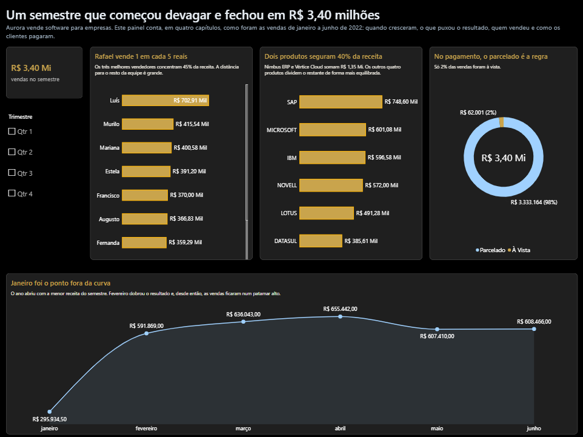

# Aurora | Sales & Business Intelligence

> Projeto de Business Intelligence e Data Visualization aplicado à análise comercial da Aurora.

## 📌 Visão geral

A Aurora é uma empresa fictícia que vende soluções de software para outras empresas. Este projeto transforma uma base de vendas em uma visão executiva do desempenho comercial no **primeiro semestre de 2022**, explorando receita, evolução mensal, produtos, vendedores e formas de pagamento.

O trabalho foi desenvolvido como atividade da disciplina **Business Intelligence e Data Visualization**, do MBA em Data Science, Inteligência Artificial e Analytics da USP.

## 🏢 Contexto

A análise considera as vendas realizadas entre janeiro e junho de 2022. A base original contém registros por vendedor, produto e forma de pagamento, com os valores organizados em colunas mensais.

## 🎯 Objetivo da análise

Construir um dashboard que permita acompanhar o resultado comercial do semestre e identificar como a receita se distribui entre os meses, vendedores, produtos e modalidades de pagamento.

## ❓ Perguntas que orientaram a análise

1. Qual foi a receita total no primeiro semestre de 2022?
2. Como a receita evoluiu mês a mês?
3. Quais vendedores concentraram os maiores valores de vendas?
4. Quais produtos representaram a maior parcela da receita?
5. Qual foi a participação das vendas parceladas e à vista?
6. Em que momento do semestre ocorreu a maior mudança no faturamento?

## 📊 Principais resultados

- 💰 **Receita no semestre:** aproximadamente R$ 3,40 milhões.
- 📅 **Menor receita mensal:** janeiro — R$ 295.934,50.
- 📈 **Maior receita mensal:** abril — R$ 655.442,00.
- 🧾 **Forma de pagamento predominante:** parcelado — aproximadamente 98% das vendas.
- 👤 **Destaque entre vendedores:** Luís — R$ 702,91 mil.
- 🧩 **Destaque entre produtos:** SAP — R$ 748,60 mil.

Os valores são apresentados conforme os rótulos e totais exibidos no dashboard. Os destaques de vendedor e produto refletem as categorias exibidas no painel.

## 🧹 Tratamento dos dados

O tratamento foi realizado no Power Query, incluindo:

- importação da planilha e seleção da aba `Consultores`;
- promoção e ajuste dos cabeçalhos;
- definição dos tipos de dados;
- preenchimento para baixo dos campos de vendedor, item e pagamento;
- padronização dos nomes dos vendedores;
- correção de “Murilu” para “Murilo”;
- transformação das colunas mensais em linhas (*unpivot*);
- tipagem da data e do valor monetário.

O código está disponível em [power-query/tratamento-dados.m](power-query/tratamento-dados.m).

## 🔎 Metodologia

**📥 Dados → 🧹 Tratamento → 📊 Análise → 📈 Visualização → 💡 Insights**

## 📊 Dashboard

A captura do relatório está disponível abaixo. O arquivo editável do Power BI será incluído em `dashboard/`.



> **Acesso interativo:** [abrir relatório no Power BI](https://app.powerbi.com/view?r=eyJrIjoiYTQyY2E5OWYtOGExNC00Y2ZjLTkwMDQtODcyNTZlZDM2ZjQxIiwidCI6IjYxOTIxZGExLTBkNDUtNDk5OS04MDQzLWYxZWM3MzIwYTYxNCJ9). A publicação online precisa receber a versão atualizada do PBIX para refletir o período de 2022.

## 📁 Estrutura

```text
dashboard-aurora-project/
├── README.md
├── dashboard/
│   └── Aurora.pbix
├── data/
│   ├── README.md
│   └── Vendas_.xlsx
├── documentation/
│   ├── analises.md
│   ├── case.md
│   ├── insights.md
│   ├── limitacoes.md
│   └── metodologia.md
├── images/
│   └── dashboard-aurora.png
└── power-query/
    └── tratamento-dados.m
```

## 🛠️ Ferramentas

- Power BI
- Power Query
- Microsoft Excel
- GitHub

## 📚 Documentação complementar

- [Contexto do desafio](documentation/case.md)
- [Metodologia de tratamento](documentation/metodologia.md)
- [Análises do dashboard](documentation/analises.md)
- [Principais insights](documentation/insights.md)
- [Limitações e pontos de atenção](documentation/limitacoes.md)

---
Projeto acadêmico desenvolvido para fins educacionais e de portfólio.
